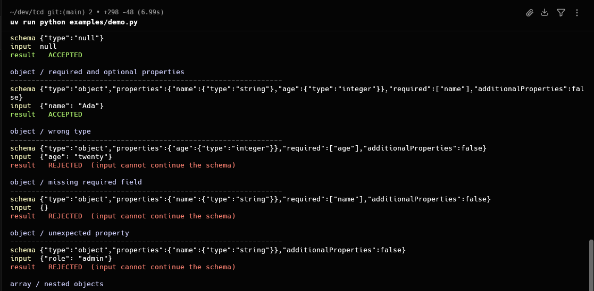

# TCD — Tiny Constrained Decoder

TCD is a small Python implementation of **token-level constrained generation** for language models. It connects a language model's tokenizer to a constraint engine that determines which tokens are allowed at each generation step.

It currently supports two constraint types:

- **Regex constraints:** Compile regular expressions into finite automata to restrict generated text to a defined pattern.
- **JSON Schema constraints:** Parse JSON incrementally and enforce a supplied schema during generation.

Rather than generating arbitrary text and validating the result afterward, TCD masks tokens that cannot lead to a valid output before sampling.

## Demonstration



*Terminal demonstration of the incremental JSON parser validating candidate inputs against different JSON Schemas.*

The experiment demonstrates how the JSON Schema constraint handles valid and invalid inputs. Valid candidates are accepted, while candidates containing incorrect types, missing required properties, or unexpected properties are rejected when they cannot continue satisfying the schema.

This is a model-free demonstration of the parser and its schema enforcement logic.

## Motivation

I stumbled across [dottxt.ai](https://dottxt.ai/) while looking for website inspiration. I didn't fully understand what the company was building, so I started exploring its work, particularly [Outlines](https://github.com/dottxt-ai/outlines), a library for generating structured outputs from language models.

I wanted to understand how constrained generation actually works under the hood rather than simply use a library that handled it for me.

That curiosity led me to build TCD from scratch and explore regex parsing, finite automata, incremental JSON parsing, tokenization, and token-level logit masking along the way.

TCD is intentionally small and focused on understanding the relationship between a constraint's state, a language model's tokenizer, and autoregressive generation. It is still under active development.

## Quick Start

TCD requires Python 3.13 or newer and uses [uv](https://docs.astral.sh/uv/) for dependency and environment management.

Clone the repository and install dependencies:

```bash
git clone https://github.com/cgnito/tcd.git
cd tcd

uv sync
```

Run the test suite:

```bash
./scripts/test.sh
```

The tests use fake models and tokenizers, so they do not require downloading the actual language model.

Run the model-free JSON Schema demonstration:

```bash
uv run python examples/demo.py
```

Run the basic generation example:

```bash
uv run python examples/basic.py
```

The decoder uses `Qwen/Qwen2.5-0.5B-Instruct` by default. Initializing `Decoder()` loads the model and tokenizer, which Transformers may download from Hugging Face on the first run.

## Usage

TCD exposes a common constraint interface through which different constraint implementations can be passed to the decoder.

### Regex Constraints

Regex constraints allow generated text to follow a specified regular expression.

```python
from tcd import Decoder, RegexConstraint

decoder = Decoder()

response = decoder.generate(
    prompt="Is Python a programming language?",
    constraint=RegexConstraint("yes|no"),
    max_tokens=10,
    temperature=0.8,
)

print(response)
```

The current supported regex subset includes:

- Literals.
- Concatenation.
- Alternation using `|`.
- Grouping using parentheses.
- Kleene star repetition using `*`.

For example:

- `"red|blue|green"` allows one of three alternatives.
- `"a(b|c)"` allows either `ab` or `ac`.

### JSON Schema Constraints

JSON Schema constraints allow generated output to follow a predefined JSON structure.

```python
from tcd import Decoder, JSONSchemaConstraint

schema = {
    "type": "object",
    "properties": {
        "name": {"type": "string"},
        "age": {"type": "integer", "minimum": 0},
        "is_student": {"type": "boolean"},
    },
    "required": ["name", "age", "is_student"],
    "additionalProperties": False,
}

decoder = Decoder()

response = decoder.generate(
    prompt="Generate a user profile.",
    constraint=JSONSchemaConstraint(schema),
)

print(response)
```

The current supported schema features include:

- **Primitive types:** `string`, `integer`, `boolean`, and `null`.
- **Objects:** `properties`, `required`, and `additionalProperties`.
- **Arrays:** A single `items` schema.
- **Nested structures:** Nested objects and arrays.
- **Enumerations:** Primitive `enum` values.
- **Integer validation:** `minimum` and `maximum`.
- **String validation:** `minLength` and `maxLength`.

The JSON parser maintains its state as tokens are generated, checking the evolving JSON structure against the compiled schema.

This allows invalid continuations to be excluded during generation instead of relying on post-generation validation.

### Running the Experiments

The examples directory contains two complementary demonstrations:

```bash
# Model-free JSON Schema parser experiments
uv run python examples/demo.py

# Actual decoder usage with regex and JSON Schema constraints
uv run python examples/experiments.py
```

The first demonstrates schema enforcement independently of a language model. The second demonstrates how developers can integrate the constraint implementations with the decoder through TCD's public API.

## How It Works

Both constraint implementations follow the same internal protocol:

```python
bind(tokenizer)
valid_token_ids()
consume_token(token_id)
is_complete()
```

This gives the decoder a consistent interface for interacting with different constraint implementations without depending on their internal parsing or validation logic.

The generation process follows this flow:

```text
             Constraint State
                    |
                    v
             Valid Token IDs
                    |
                    v
               Logit Masking
                    |
                    v
               Token Sampling
                    |
                    v
             State Transition
                    |
                    v
             Completion Check
                    |
              Continue / Stop
```

At each generation step, the constraint determines which token IDs are valid. The decoder masks the logits of disallowed tokens before sampling, ensuring that generation follows the active constraint.

The two constraint implementations handle this differently:

- **Regex:** Regular expressions are parsed into an NFA and converted into a DFA. The DFA tracks the current state and determines which token continuations are valid.
- **JSON Schema:** The schema is compiled into an internal representation. An incremental JSON parser uses a stack of structural contexts and schema information to track and validate the evolving output.

`TokenIndex` provides a shared decoded-vocabulary cache and candidate index. It decodes the vocabulary once and groups tokens by their first character to reduce repeated token lookups during generation.

## Project Structure

```text
src/tcd/
├── decoder.py
│   └── Model execution, sampling, and logit masking.
│
├── regex/
│   └── state.py
│       └── Regex parsing, NFA construction, and DFA construction.
│
├── constraints/
│   ├── protocol.py
│   │   └── Internal constraint interface used by the decoder.
│   ├── regex.py
│   │   └── RegexConstraint implementation.
│   ├── json_schema.py
│   │   └── JSONSchemaConstraint implementation.
│   └── token_index.py
│       └── Shared vocabulary cache and candidate index.
│
└── json_parser/
    ├── state.py
    │   └── Incremental JSON parser and structural state.
    └── schema.py
        └── Supported JSON Schema nodes and compiler.
```

## Current Limitations

TCD is an experimental implementation, not a complete JSON Schema or regex engine.

Current limitations include:

- Only a subset of JSON Schema keywords and types is supported.
- The regex implementation supports a limited set of regular expression constructs.
- Tokenizer integration currently decodes individual token IDs and may not handle every byte-level or context-sensitive tokenizer behavior.
- Streaming generation and a production-ready inference backend are not yet implemented.

The project is still evolving, and these limitations represent areas for further development.

## Contributing

Contributions that improve correctness, clarity, testing, or measured performance are welcome.

Before opening a change:

1. Keep behavior focused on the currently supported constraint subset.
2. Add or update tests under `tests/unit/`, `tests/integration/`, or `tests/e2e/` as appropriate.
3. Run the full test suite:

   ```bash
   ./scripts/test.sh
   ```

4. Explain behavioral changes and performance claims with reproducible examples or measurements.

## Notes

The [`notes/`](notes/) directory contains my working explanations and learning notes as I build the project.

For a quick overview of how constraints interact with the decoder, see [`notes/constraint-flow.md`](notes/constraint-flow.md).