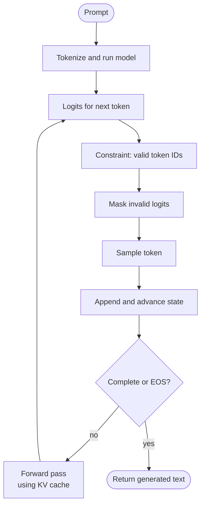

# TCD — Tiny Constrained Decoder


TCD is a small, from-scratch implementation of **token-level constrained generation** for language models. At each generation step, it masks tokens that would violate a regular expression or JSON Schema, so the model samples only from continuations that are valid at that point.

TCD is an experimental learning and research project. It is not production-ready, and it does **not** guarantee that every generation will complete successfully.

## The problem

Language models generate text one token at a time. If an application needs structured output, a common approach is:

1. generate freely,
2. validate the result,
3. retry if validation fails.

That works, but it wastes generation on outputs that were never going to be usable. TCD takes the constrained-decoding approach instead: the constraint is consulted before sampling, and invalid token choices are removed from the distribution.

The important qualification is that this is **local** validity. TCD prevents the next token from being invalid given the current state. It does not search ahead, backtrack, or guarantee that a valid completion exists before the token limit is reached.

## Motivation

I discovered structured generation through [.txt](https://dottxt.ai/) and [Outlines](https://github.com/dottxt-ai/outlines). I wanted to understand how constrained generation actually works rather than only use a library that implements it. That led to building TCD from scratch: tokenizer handling, autoregressive generation, finite automata, incremental JSON parsing, token masking, and the experiment in this repository.

TCD is intentionally small and readable. The goal is to make the underlying mechanisms inspectable.

## How it works



The constraint interface is deliberately narrow:

```python
bind(tokenizer)
valid_token_ids()
consume_token(token_id)
is_complete()
```

`valid_token_ids()` is a non-mutating query. `consume_token()` commits the sampled token to the constraint state. This separation is what makes candidate validation possible without corrupting the current parser or automaton state.

## Supported constraints

### Regex

The regex constraint compiles the pattern to a Thompson NFA, converts it to a DFA by subset construction, and checks candidate token text against the DFA.

Supported syntax:

- literals
- concatenation
- alternation with `|`
- grouping with parentheses
- Kleene star with `*`

Examples:

```text
red|blue|green
a(b|c)
ab*
```

Not supported: character classes, `+`, `?`, anchors, and escape sequences.

### JSON Schema

The JSON Schema constraint compiles a supported subset of JSON Schema into internal schema nodes, then parses the generated document incrementally. It tracks structural state, schema state, property names, required properties, and completed values.

Supported features:

| Feature | Support |
|---|---|
| Primitive types | `string`, `integer`, `boolean`, `null` |
| Objects | `properties`, `required`, `additionalProperties` |
| Arrays | one `items` schema |
| Nesting | nested objects and arrays |
| Enumerations | primitive `enum` values |
| Integers | `minimum`, `maximum` |
| Strings | `minLength`, `maxLength` |

Not supported: floating-point numbers, `number`, `oneOf`/`anyOf`/`allOf`, `pattern`, tuples, and other JSON Schema keywords outside the table above.

## Quick start

TCD requires Python 3.13 or newer and uses [uv](https://docs.astral.sh/uv/).

```bash
git clone https://github.com/cgnito/tcd.git
cd tcd
uv sync
```

Run the tests:

```bash
./scripts/test.sh
```

The tests use fake models and tokenizers, so they do not download a language model.

## Minimal example

```python
from tcd import Decoder, JSONSchemaConstraint

schema = {
    "type": "object",
    "properties": {
        "name": {"type": "string"},
        "age": {"type": "integer", "minimum": 0},
        "is_student": {"type": "boolean"},
    },
    "required": ["name", "age", "is_student"],
    "additionalProperties": False,
}

decoder = Decoder()
response = decoder.generate(
    prompt="Generate a user profile.",
    constraint=JSONSchemaConstraint(schema),
    max_tokens=100,
    temperature=0.8,
)

print(response)
```

`Decoder()` loads `Qwen/Qwen2.5-0.5B-Instruct` by default. Transformers may download the model on first use.

Regex constraints use the same decoder API:

```python
from tcd import Decoder

decoder = Decoder()
response = decoder.generate(
    prompt="Is Python a programming language?",
    constraint="yes|no",
    max_tokens=10,
    temperature=0.8,
)
print(response)
```

A string constraint is automatically converted to a `RegexConstraint`.

## Examples

```bash
# Model-free JSON Schema parser demonstration
uv run python examples/demo.py

# Interactive regex generation example
uv run python examples/basic.py

# Full decoder examples with JSON Schema and regex constraints
uv run python examples/experiments.py
```

`examples/demo.py` does not load a model. The other two examples download and run Qwen on CPU.

## Tests

```bash
./scripts/test.sh
```

or directly:

```bash
uv run pytest -q
```

The suite covers the regex parser and DFA, the incremental JSON parser and schema compiler, constraint adapters, decoder integration, the public API, and the benchmark pipeline.

## Benchmark

TCD includes an exploratory benchmark comparing three approaches on five JSON-generation tasks:

1. **Normal prompting:** generate once, validate afterward.
2. **Retry:** generate, validate, and retry up to three times.
3. **Constrained decoding:** generate with a `JSONSchemaConstraint`.

The published run uses `Qwen/Qwen2.5-0.5B-Instruct` with chat-template prompting, 5 runs per task, 100 maximum tokens, temperature `0.8`, and seeds derived from a fixed base. There are 25 observations per approach.

Primary results use strict validation: `json.loads` must parse the output exactly as generated. Markdown fences are therefore invalid.

| Approach | Strict schema-valid | Fence-stripped valid | Mean latency | Tokens/s |
|---|---:|---:|---:|---:|
| Normal | 7/25 | 23/25 | 9.21s | 3.90 |
| Retry | 10/25 | 24/25 | 25.12s | 4.45 |
| Constrained | 19/25 | 19/25 | 27.86s | 1.53 |

The fence-stripped column is a **post-hoc sensitivity analysis**, not a replacement for the primary results. Almost all unconstrained failures were valid JSON wrapped in Markdown fences. Once those fences are removed, normal and retry prompting are more schema-valid than constrained decoding in this run.

All six constrained failures were truncations at the 100-token limit; every constrained output that reached `constraint_complete` was schema-valid. The benchmark is exploratory: 25 observations per approach are enough to illustrate behaviour, not to establish statistical significance.

Reproduce the experiment:

```bash
uv run python -m benchmark.run_benchmark
uv run python -m benchmark.analyze
```

The published run is in [`benchmark/results/published/`](benchmark/results/published/). The JSONL contains one observation per line; the metadata records the model, environment, generation settings, prompts, rendered chat prompts, and schemas.

See [`docs/benchmarking.md`](docs/benchmarking.md) for the full methodology, per-task results, failure analysis, and threats to validity.

## Current limitations

- Constraint checks are local. TCD can enter a state with no valid next token and raise an error; it does not backtrack.
- Generation can still hit `max_tokens` before a constrained document is complete.
- The regex engine supports only a small subset of regular expressions.
- The JSON Schema implementation supports only a small subset of JSON Schema.
- Token candidates are decoded individually. Context-sensitive or byte-level tokenizer behaviour may not be handled perfectly.
- The decoder runs on CPU with Hugging Face Transformers and is not a production inference backend.
- Streaming generation is not implemented.
- The benchmark uses one model, one hardware environment, and a small sample.

## Documentation

- [`docs/architecture.md`](docs/architecture.md): decoder, tokenizer, constraint protocol, regex automata, and incremental JSON parsing.
- [`docs/benchmarking.md`](docs/benchmarking.md): experiment design, metrics, published results, failure analysis, and limitations.
- [`docs/design-decisions.md`](docs/design-decisions.md): parser cloning, performance optimisations, EOS handling, and special-token exclusion.

## Project structure

```text
src/tcd/
├── decoder.py                 # Model execution, sampling, logit masking
├── constraints/
│   ├── protocol.py            # Constraint interface
│   ├── regex.py               # Regex constraint adapter
│   ├── json_schema.py         # JSON Schema constraint adapter
│   └── token_index.py         # Vocabulary cache and candidate index
├── regex/
│   └── state.py               # Regex parser, NFA, and DFA
└── json_parser/
    ├── schema.py              # Supported JSON Schema compiler
    └── state.py               # Incremental JSON parser

benchmark/
├── dataset.py                 # Five benchmark tasks
├── runner.py                  # Three benchmark approaches
├── run_benchmark.py           # Experiment entry point
├── analyze.py                 # Aggregation and failure analysis
└── results/published/         # Published raw run

docs/                          # Technical documentation
examples/                      # Model-free and decoder examples
tests/                         # Unit, integration, e2e, and benchmark tests
```

## Contributing

Contributions that improve correctness, clarity, testing, or measured performance are welcome.

Before opening a change:

1. Keep behaviour within the supported constraint subsets.
2. Add or update tests under `tests/unit/`, `tests/integration/`, `tests/e2e/`, or `tests/benchmark/`.
3. Run `./scripts/test.sh`.
4. Run `uv run ruff check .`.
5. Explain behavioural changes and performance claims with reproducible examples or measurements.

## License

MIT. See [`LICENSE`](LICENSE).
