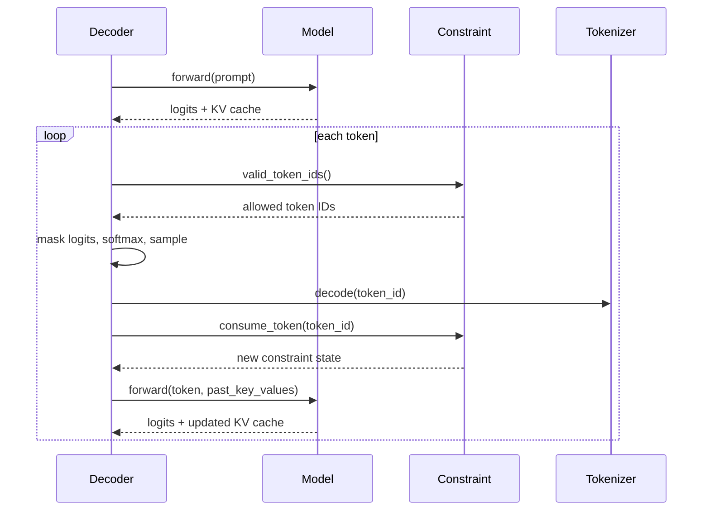
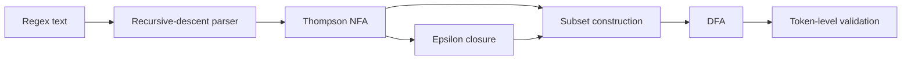

# Architecture

This document explains how TCD turns a language model's next-token distribution into a constrained sample. It covers the decoder loop, the constraint interface, the vocabulary index, the regex implementation, and the incremental JSON Schema parser.

The central design separation is:

- **The decoder** owns the model, tokenizer, sampling, and logit masking.
- **A constraint** owns the set of valid next tokens and the state that advances when one is selected.
- **`TokenIndex`** translates between token IDs and decoded text so constraints can reason in characters and JSON rather than model-specific token IDs.

## Data flow

```text
prompt
  -> tokenizer
  -> input_ids
  -> model forward pass
  -> next-token logits
  -> constraint.valid_token_ids()
  -> additive -inf mask
  -> temperature scaling
  -> softmax
  -> multinomial sampling
  -> constraint.consume_token()
  -> next model forward pass with KV cache
```

At no point does the decoder ask the model to generate freely and then rewrite the output. The constraint acts directly on the sampling distribution.

## Decoder and tokenizer

`Decoder` is defined in [`src/tcd/decoder.py`](../src/tcd/decoder.py).

```python
class Decoder:
    def __init__(self, model_name="Qwen/Qwen2.5-0.5B-Instruct"):
        self.model = AutoModelForCausalLM.from_pretrained(model_name)
        self.tokenizer = AutoTokenizer.from_pretrained(
            model_name,
            padding_side="left",
        )
        self.model.to("cpu")
```

The tokenizer converts the prompt into model input IDs. The model produces logits for the next token at every position; TCD uses only the final position for the next-token decision.

The implementation uses the model's KV cache. The prompt is processed once, then each newly selected token is passed back to the model with `past_key_values` from the previous forward pass. TCD does not call `model.generate()`; the loop is explicit so that masking and constraint updates happen in the right place.

Model and tokenizer both provide EOS configuration. `_eos_token_ids()` reads EOS IDs from `model.generation_config.eos_token_id` and `tokenizer.eos_token_id`, because they are not always the same. See [`design-decisions.md`](design-decisions.md#eos-handling).

## The generation loop

The loop in `Decoder.generate()` is:

1. Convert a string constraint to a `RegexConstraint`.
2. Call `constraint.bind(tokenizer)` once for this generation call.
3. Tokenize the prompt and run the model.
4. For each generation step:
   1. Read the logits for the final position.
   2. Ask the constraint for allowed token IDs.
   3. Build an additive mask with `0` for allowed IDs and `-inf` for all others.
   4. Add the mask to the logits.
   5. Scale by temperature and apply softmax.
   6. Sample one token with `torch.multinomial`.
   7. Stop if the token is EOS in unconstrained generation.
   8. Decode and append the token.
   9. Commit the token to the constraint.
   10. Stop if the constraint is complete or the token limit is reached.
   11. Run the model on the new token using the KV cache.



If a constraint reports no valid token IDs, `Decoder.generate()` raises `ValueError`. This is a dead-end state: the current prefix is valid, but no vocabulary token can continue it under the constraint.

### Finish reasons

`_metrics["finish_reason"]` records why generation stopped:

- `constraint_complete`: the constraint reported completion.
- `eos`: an unconstrained generation emitted an EOS token.
- `max_tokens`: the token budget was exhausted.

`tokens_generated` includes the sampled token even when that token is EOS. The decoded EOS text is not appended to the response.

In constrained generation, TCD does not treat EOS as a normal stop condition. Special tokens are excluded from the candidate index, so constrained generation stops when the constraint completes or the token limit is reached.

## The constraint interface

The interface is defined as a `typing.Protocol` in [`src/tcd/constraints/protocol.py`](../src/tcd/constraints/protocol.py).

```python
class Constraint(Protocol):
    def bind(self, tokenizer) -> None: ...
    def valid_token_ids(self) -> list[int]: ...
    def consume_token(self, token_id: int) -> None: ...
    def is_complete(self) -> bool: ...
```

The contract is:

- `bind()` attaches a tokenizer and prepares vocabulary lookup.
- `valid_token_ids()` must not mutate constraint state. It is a candidate query.
- `consume_token()` commits one sampled token and advances the state.
- `is_complete()` reports whether the generated prefix is a complete valid output.

This split is why candidate checks can clone parser state or simulate DFA transitions without changing the live state.

## TokenIndex

`TokenIndex` is defined in [`src/tcd/constraints/token_index.py`](../src/tcd/constraints/token_index.py).

Tokenizers expose vocabulary entries as text-to-ID mappings. Constraints need the inverse mapping and the decoded text for each ID. `TokenIndex` builds both once per `bind()` call:

- It calls `tokenizer.get_vocab()`.
- It skips all IDs in `tokenizer.all_special_ids`.
- It decodes each remaining ID individually with `skip_special_tokens=False` and `clean_up_tokenization_spaces=False`.
- It stores the decoded text by ID.
- It groups entries by their first character.

The first-character grouping lets a constraint ask only for tokens that can begin at the current state. For example, when the JSON parser expects a property key, only tokens whose decoded text starts with `"` need to be tested.

String content is special: almost any non-control character can continue an open JSON string. In that state, `valid_symbols()` returns `None`, and `TokenIndex.entries(None)` returns all cached entries.

`TokenIndex` is rebuilt for every `generate()` call because the constraint is bound per call. In the benchmark, that cost is measured as `bind_time_s`.

### Tokenizer assumptions

Decoding one token in isolation is an approximation. It works well for the tokenizers used in this project, but byte-level tokenizers can depend on surrounding context, and a token's decoded text may not be a clean character continuation. This is a known limitation, not a correctness guarantee for every tokenizer.

## Regex constraint

The regex implementation is split into:

- [`src/tcd/regex/state.py`](../src/tcd/regex/state.py): parser, NFA, and DFA.
- [`src/tcd/constraints/regex.py`](../src/tcd/constraints/regex.py): adapter to the constraint interface.

### Supported grammar

```text
expr   = term ('|' term)*
term   = factor+
factor = atom ('*')?
atom   = literal | '(' expr ')'
```

This is intentionally small. It supports literals, concatenation, alternation, grouping, and Kleene star. It does not support character classes, `+`, `?`, anchors, or escapes.

### Thompson construction

The parser builds an NFA using Thompson-style fragments:

- A literal creates a start state and an accept state connected by one symbol transition.
- Concatenation connects the first fragment's accept state to the second fragment's start state with an epsilon transition.
- Alternation creates a new start state with epsilon transitions to both alternatives, and a new accept state reached from both.
- Star creates a loop from the fragment's accept state back to its start state, plus an epsilon path that skips the fragment.



### NFA to DFA

`DFA` performs subset construction:

1. Start with the epsilon closure of the NFA start state.
2. For each reachable set of NFA states and each alphabet symbol, compute the next set.
3. Name each distinct set as a DFA state.
4. Mark a DFA state accepting if it contains the NFA accept state.

The alphabet is the set of literal symbols used by the pattern.

### Token validation

For each candidate token, `RegexConstraint`:

1. Gets the token's cached text from `TokenIndex`.
2. Simulates the DFA from the current state.
3. Rejects the token if any character has no transition.

The simulation uses local state and does not mutate the DFA. Only `consume_token()` advances `dfa.current_state`.

A token can contain multiple characters, so a single token may advance several DFA states. TCD checks the entire token text before allowing it.

## JSON Schema constraint

The JSON implementation is split into:

- [`src/tcd/json_parser/schema.py`](../src/tcd/json_parser/schema.py): schema compilation.
- [`src/tcd/json_parser/state.py`](../src/tcd/json_parser/state.py): incremental parser.
- [`src/tcd/constraints/json_schema.py`](../src/tcd/constraints/json_schema.py): adapter to the constraint interface.

### Schema compilation

`compile_schema()` converts a supported JSON Schema dictionary into frozen dataclasses:

- `PrimitiveSchema`: type, optional enum, integer bounds, string length bounds.
- `ObjectSchema`: property schemas, required names, `additionalProperties` policy.
- `ArraySchema`: one `items` schema.

Unknown keywords are rejected. This is deliberate: silently ignoring unsupported keywords would create a misleading guarantee.

### Parser state

`JsonParserState` maintains the evolving document. Its main state is a stack of container frames plus an active scalar mode.

```text
structural
  |-- object frame: key_or_end -> key -> colon -> value -> comma_or_end
  |-- array frame: value_or_end -> value -> comma_or_end
  |-- string value/key: string -> string_escape -> unicode_escape
  |-- number: sign -> zero/digits
  `-- literal: true / false / null
```

A stack frame records:

- the container kind,
- the current phase,
- the schema for the container,
- for objects, the names already seen and the pending property schema.

The parser can be in an incomplete but valid state. For example, `{"name":` is valid as a prefix even though it is not a complete document.

### Incremental validation

At each step, `valid_symbols()` reports either:

- a finite set of characters that can be consumed next, or
- `None` when the parser is inside string content and almost any non-control character is allowed.

`JSONSchemaConstraint.valid_token_ids()` asks `TokenIndex` for candidates matching those first symbols, then checks each full token with `JsonParserState.can_consume()`.

`can_consume()` clones the parser, consumes the token text on the clone, and returns whether every character was accepted. The live parser is unchanged.

`consume_token()` performs the same operation on a clone and then commits the clone's state only if the whole token is valid. This makes token consumption atomic: a token that fails halfway cannot leave the parser partially advanced.

### Schema checks

Schema constraints are checked at value boundaries:

- primitive type at value start,
- enum membership at completed value,
- integer minimum/maximum at completed value,
- string minLength/maxLength at completed value,
- unknown properties when a key is finished,
- duplicate properties when a key is finished,
- required properties when an object closes.

For integers, the parser also checks whether the current number is still allowed before generation finishes. The supported number subset is integer-only: no decimal point, exponent, or leading zero.

### Local validity and dead ends

TCD validates the next token, not the existence of a complete future path. A parser state can be locally valid yet unable to reach a completion within the token budget. Examples include:

- an object whose required property has not yet been generated,
- a string that has exceeded its `maxLength` but has no closing quote token that passes validation,
- a token limit reached before the closing braces.

When no candidate token is valid, the decoder raises `ValueError`. When the token limit is reached first, the output is truncated.

This distinction matters for interpreting the benchmark. TCD enforces valid transitions; it does not prove that a valid final document will be produced.

## Source map

| File | Responsibility |
|---|---|
| `src/tcd/decoder.py` | Model loading, tokenization, generation loop, masking, sampling, EOS handling. |
| `src/tcd/constraints/protocol.py` | Constraint interface. |
| `src/tcd/constraints/token_index.py` | Vocabulary decoding, special-token filtering, first-character index. |
| `src/tcd/constraints/regex.py` | Regex constraint adapter. |
| `src/tcd/regex/state.py` | Regex parser, Thompson NFA, subset-construction DFA. |
| `src/tcd/constraints/json_schema.py` | JSON Schema constraint adapter. |
| `src/tcd/json_parser/schema.py` | Supported schema compiler. |
| `src/tcd/json_parser/state.py` | Incremental JSON parser and parser state transitions. |
